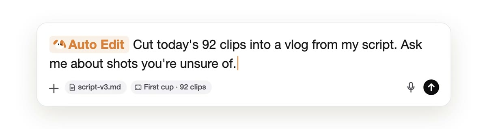
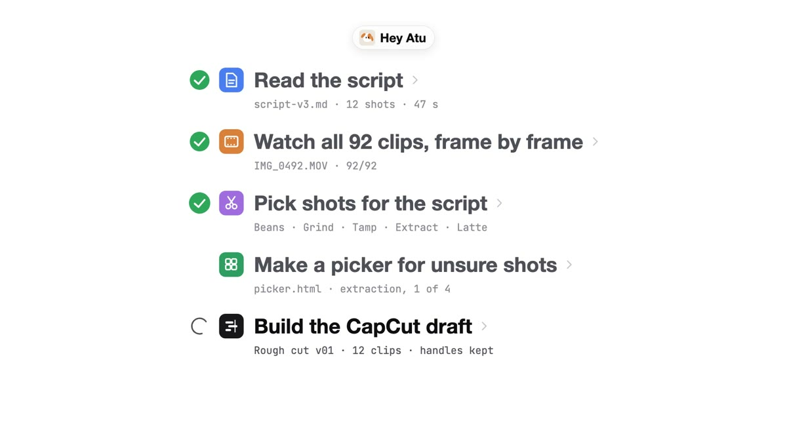
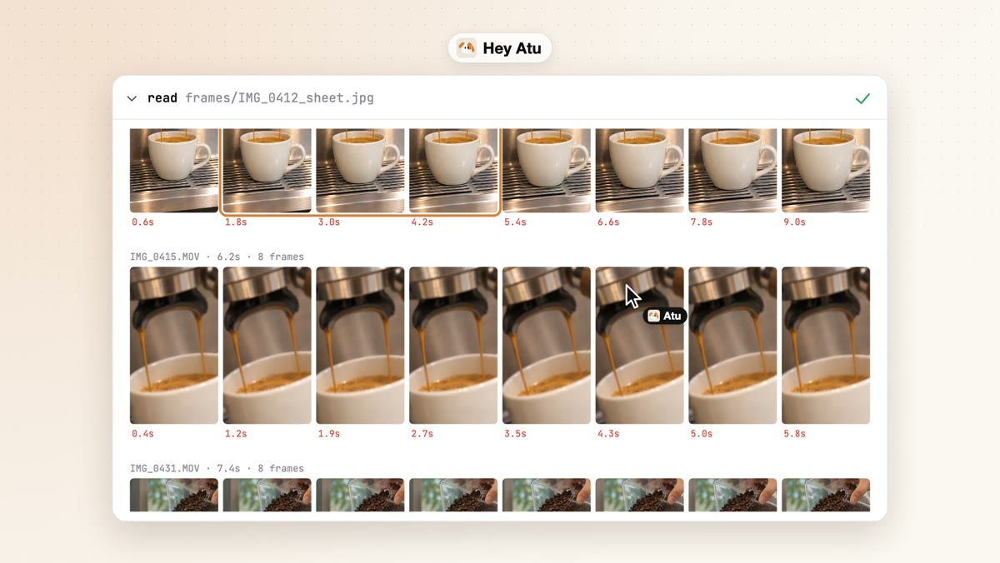
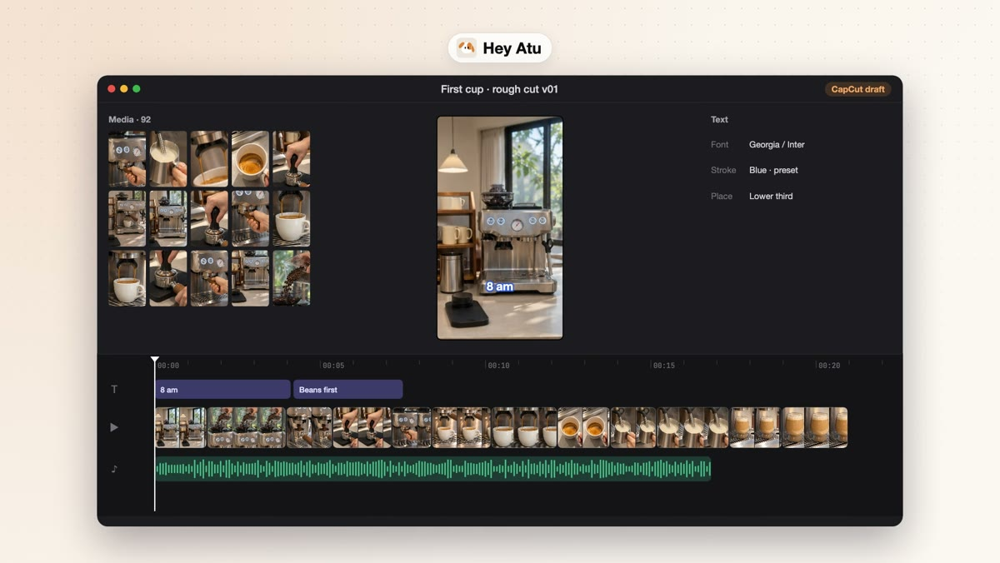

# Hey Atu Skills

**English** | [简体中文](README.zh-CN.md)

**🐶 [heyatu.com](https://heyatu.com) · [中文](https://heyatu.com/zh)**: Hey Atu keeps your AI working on your Mac, from your phone.

Free Skills from [Hey Atu](https://heyatu.com), in the open [Agent Skills](https://agentskills.io) format. They are written for Atu on your Mac, and work in other agents that read `SKILL.md` (Claude Code, Codex, Cursor and more).

| Skill | What it does |
|---|---|
| [auto-edit](skills/auto-edit/) | Give it a folder of footage and your script (or let it suggest one); it watches every clip, lets you pick takes on one page, and exports a first cut as an MP4 and an editable 剪映 (CapCut / Jianying Pro) draft. Mac. |

## How to use auto-edit

Two ways to use the same Skill. **Hey Atu is recommended:** its three-pane window shows the chat, your files and a preview side by side, so the take picker and the cut open and play next to the chat, and you can pick takes on your phone too.

### In Hey Atu

> The pictures are stills from the Hey Atu Auto Edit promo film (sample footage of a morning coffee); screenshots of the app follow.

1. [Download Hey Atu for Mac](https://heyatu.com) and sign in.
2. In a new chat, send Atu:

   ```text
   Install this Skill: https://raw.githubusercontent.com/hancyhxy/heyatu-skills/main/install.md
   ```

3. Open a new chat, type `/`, pick **auto-edit**, drop in a footage folder (music files go in the same folder) and say what the video is about, or ask Atu to suggest a script.
   

4. Atu lists its steps and ticks them off:

   

5. It watches every clip on contact sheets with timestamps and marks the parts to use:

   

6. Every shot with more than one usable take goes on one **take picker**, Atu's pick preselected. Choose, then send Atu the line at the bottom:

   

7. Atu exports an MP4, and a 剪映 / CapCut draft with the full clips and trim handles when 剪映 Pro is installed:

   

### In your own terminal (Claude Code, Codex, Pi and other agents)

Needs Node.js 20+.

```sh
npx skills add hancyhxy/heyatu-skills -g
```

Or copy `skills/auto-edit` into your agent's Skills folder (`~/.claude/skills/`, `~/.codex/skills/`, `~/.pi/agent/skills/`). Start a new session and say: "Use auto-edit to cut ~/Movies/Trip into a 30-second vertical vlog". The picker opens in your browser; paste the line at its bottom back into the terminal. Cuts are in `auto-edit/exports/` inside the footage folder.

## Repository

```text
skills/<name>/   one Skill: SKILL.md, its documents, scripts/ and assets/
install.md       the install steps that Atu follows
```

Add a Skill: create `skills/<name>/SKILL.md` with `name: <name>` and a `description`. Scripts use Node 20+ and no npm packages, so a Mac with Hey Atu needs nothing else. A Skill that needs a program downloads it in its own `scripts/setup.mjs` into its `bin/` folder (not committed).

## Licence

MIT, see [LICENSE](LICENSE). Third-party parts are listed in [NOTICE](NOTICE).
