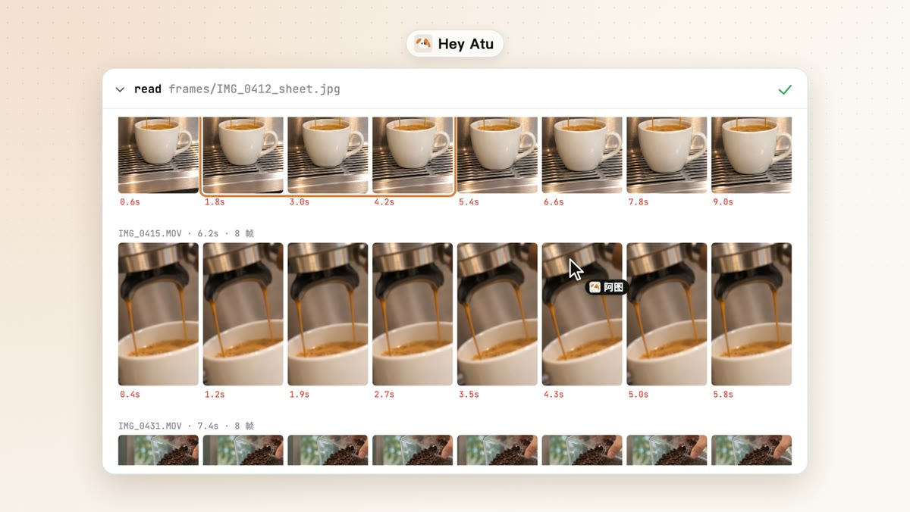
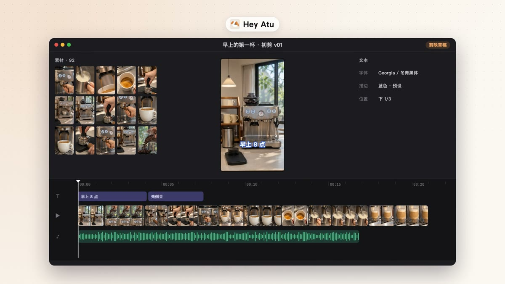

# Hey Atu Skills

[English](README.md) | **简体中文**

**🐶 [heyatu.com/zh](https://heyatu.com/zh)**：Hey Atu 让你的 AI 在 Mac 上一直干活，手机上随时跟进。

[Hey Atu](https://heyatu.com/zh) 出品的免费 Skill，使用开放的 [Agent Skills](https://agentskills.io) 格式。为 Mac 上的阿图而写，也能在其他读 `SKILL.md` 的 AI 助手里用（Claude Code、Codex、Cursor 等）。

| Skill | 做什么 |
|---|---|
| [auto-edit 自动剪辑](skills/auto-edit/) | 给它一个素材文件夹和你的脚本（或者让它推荐一个），它看完每条素材，在一页里让你选 take，导出 MP4 初剪和可以接着改的剪映草稿。Mac。 |

## 自动剪辑 Skill 怎么用

**你拍、你定脚本、你选 take；阿图看素材、排片、出 MP4 和剪映草稿。** 素材全程留在你的 Mac 上。

有两种用法，Skill 是同一个：

| | 在 Hey Atu 里用（推荐） | 在自己的终端里用 |
|---|---|---|
| 适合谁 | 所有人，不用懂命令行 | 已经在用 Claude Code、Codex 等终端 AI 助手的人 |
| 安装 | 复制一句话发给阿图 | 一条命令 |
| 看选片页和成片 | 对话、文件、预览三栏并排：选片页和视频直接在对话旁边打开、能播放，手机上也能看、能选 | 在浏览器和 QuickTime 里另开窗口 |

### 方式一：在 Hey Atu 里用（推荐）

> 下面的图是 Hey Atu 自动剪辑宣传片里的示意画面（虚构的「早上做一杯咖啡」素材），真实界面截图稍后补上。

**安装（只做一次）**

1. 下载 [Hey Atu Mac 版](https://heyatu.com/zh) 并登录。
2. 新开一个对话，把这句话发给阿图：

   ```text
   帮我安装这个 Skill：https://raw.githubusercontent.com/hancyhxy/heyatu-skills/main/install.md
   ```

3. 阿图回复「装好了」后，**新开一个对话**。

**剪一条视频**

1. 把这次的视频放进一个文件夹。要配音乐的话，把音乐文件（mp3、m4a…）也放进去。
2. 在输入框打「/」，选 **auto-edit**，把文件夹拖进对话，再说一句想要什么：
   > 剪成 30 秒竖屏 vlog，纯 BGM：出门 → 路上 → 到海边。

   没想好脚本也行，说「你看着剪」，阿图看完素材会按模板推荐一个，你确认或改几句。
   

   阿图会列出它要做的步骤，一步步打勾：

   

   它把每条素材拼成带秒数的缩略图，一张张看完，标出要用的片段：

   

3. 阿图看完全部素材，会在右侧预览栏打开**选片页**：同一个镜头有几条能用的 take 都在这一页，已经预选好。点「选」换掉，把页面底部那句话发回给阿图。出门在外也可以在手机上选。

   

4. 阿图出片，成片直接在预览栏播放：
   - MP4 初剪（原分辨率，iPhone HDR 自动校色）和 SRT 字幕；
   - 装了剪映专业版的话，剪映首页会多一个草稿，用的是完整原片，可以接着修剪、换镜头、加特效。

   

5. 想改就直接说「第 3 段换一个」「开头短一点」，阿图会再出选片页或新版本，旧版本都保留。

### 方式二：在自己的终端里用

适用于 Claude Code、Codex、Pi，以及其他能读 `SKILL.md`、能运行命令的 AI 助手。电脑需要装好 Node.js 20 或更新版本。

**安装**

```sh
npx skills add hancyhxy/heyatu-skills -g
```

按提示选你用的助手（Claude Code、Codex……），`-g` 表示装给所有项目。也可以手动装：下载本仓库，把 `skills/auto-edit` 复制到助手的 Skills 文件夹（Claude Code：`~/.claude/skills/`，Codex：`~/.codex/skills/`，Pi：`~/.pi/agent/skills/`）。装好后**重开一个会话**。

**剪一条视频**

在终端里打开助手，直接说：

```text
用 auto-edit 帮我剪 ~/Movies/Trip 这个文件夹，30 秒竖屏 vlog，纯 BGM：出门 → 路上 → 到海边
```

- 第一次使用时，Skill 会自动下载 FFmpeg（约 30 MB）。
- 选片页会用浏览器打开，选好后把页面底部那句话粘贴回终端。
- 成片在素材文件夹的 `auto-edit/exports/` 里，用 QuickTime 打开；剪映草稿同样会出现在剪映首页。

### 模板

没有脚本时，阿图可以用这些模板（内容 × 声音任意组合）：

- 内容：一日 vlog、旅行/出门、好物/种草、健身训练、混剪卡点
- 声音：带 BGM（音乐 + 原声）、纯 BGM、原声、后配口播（阿图按你的旁白文字排画面，你在剪映里录音）

### 需要什么

- 一台 Mac，和一个能看图的模型（阿图要看你的素材）。
- 剪映专业版（Mac）：可选，想手动精修时用。没有也能拿到 MP4。
- 音乐：Skill 不自带，请用你有权使用的音乐。

### 目前做不到

- 听不到素材里的说话声：对着镜头说话的视频只能按画面剪，请检查有没有切断句子。
- 只支持 Mac。

问题和建议：[提 Issue](https://github.com/hancyhxy/heyatu-skills/issues)。

## 仓库结构

```text
skills/<name>/   一个 Skill：SKILL.md、说明文档、scripts/ 和 assets/
install.md       阿图安装时照着做的步骤
```

## 许可

MIT，见 [LICENSE](LICENSE)。第三方部分见 [NOTICE](NOTICE)。
